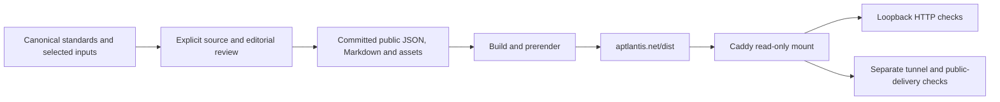

<p align="center">
  <a href="https://aptlantis.net"></a>
</p>

<p align="center">
  <a href="#working-commands"></a>
  <a href="aptlantis.net/package.json"></a>
  <a href="aptlantis.net/public/city-hall/resources/LICENSE.txt"></a>
</p>

<!-- Explicit dark images also work when a README renderer omits picture/source elements. -->

This workspace contains the public **Aptlantis City Hall website**, companion documentation sites, and their local static-serving configuration. City Hall offers standards, records, templates and tools that people can adapt one piece at a time. The website explains reviewed snapshots; canonical standards remain under `D:\.city_hall`.

**Source review: 2026-11-19.** The Git working tree is rooted at `A:\`. This overview reflects the current files and package metadata. Dated acceptance records below retain their original scope and dates; this documentation refresh does not renew their runtime or publication evidence.

[Find a useful part](https://aptlantis.net/city-hall/find) · [Site guide](aptlantis.net/README.md) · [Documentation sites](#companion-documentation) · [Working commands](#working-commands) · [Verification](#verification-and-current-boundaries)

| Location                             | Role                                                                                         | Start here                                                     |
| ------------------------------------ | -------------------------------------------------------------------------------------------- | -------------------------------------------------------------- |
| `aptlantis.net/`                     | React/Vite website, reviewed public data/assets, editorial tools and optional services.      | [Site README](aptlantis.net/README.md)                         |
| `doc-sites/Command-Wizard/`          | Starlight application documentation with selected screenshots and source records.            | [CommandWizard guide](doc-sites/Command-Wizard/README.md)      |
| `doc-sites/Logos-Themes/`            | Theme documentation, provenance, audits and isolated visual reviews.                         | [Logos & Themes guide](doc-sites/Logos-Themes/README.md)       |
| `doc-sites/Aptlantis-SiYuan/`        | Local Starlight handbook for private plugins and Aptlantis themes.                           | [SiYuan handbook guide](doc-sites/Aptlantis-SiYuan/README.md)  |
| `webserver/`                         | Caddy/Compose configuration, separate phpBB operations and retained infrastructure material. | [Webserver README](webserver/README.md)                        |
| `aptlantis.net/docs/Narrative-Pack/` | Supplied explanation material used for editorial orientation.                                | [Narrative guide](aptlantis.net/docs/Narrative-Pack/README.md) |
| `images/`                            | Shared supplied screenshots and supporting media.                                            | Preserve source identity and review before reuse.              |

## Where to begin

Start at [Find the Part You Need](https://aptlantis.net/city-hall/find): identify a familiar problem, narrow the situation, and inspect or download one suggested piece. The [Walkthrough](https://aptlantis.net/walkthrough) explains the operating model. The [standards catalog](https://aptlantis.net/city-hall) explains individual responsibilities, while [Resources](https://aptlantis.net/city-hall/resources) supports direct browsing. [SVG Lab](https://aptlantis.net/svg-lab) is a browser-local metadata workbench.

Maintainers should read the [site operating guide](aptlantis.net/AGENTS.md), then the README for the subsystem being changed. Use each project's package metadata and lockfile for its tools and versions. Some older subsystem guides still name earlier pnpm versions; the main site's current `packageManager` pins **pnpm 12.9.1**. These guides describe implementation and operations; canonical governance remains separate.

## What is implemented now

- **16 component explanations:** curated teaching sections, adoption guidance, 16 detailed Markdown documents and 24 approved example assets. Catalog identity, illustrative examples and recorded observations remain distinct.
- **Four-chapter Walkthrough:** stable URLs, section anchors, chapter navigation and synchronized Markdown. Home and catalog cards use SESM SVG logos with embedded raster artwork; PNG compatibility assets remain available.
- **50-file selected resource pack:** 14 catalog families, adaptation notes, review dates, relative provenance and SHA-256 values. The earlier picker retains 28 outcomes. Find the Part You Need uses 25 broad problems, 24 reusable narrower families and 48 outcomes across 103 complete paths. Guided navigation and phrase-based search share the same records.
- **Browser-local SVG Lab:** XML/schema/safe-profile checks, metadata editing, explicit embedding/replacement, raster wrapping, comparison and exports. It uses a reviewed SESM 0.3.0 snapshot with 0.2.0 compatibility and keeps assets in memory. Its isolated preview and validation do not establish ownership, provenance, cryptographic authenticity or exhaustive sanitization.
- **Blue Slate site profile:** documented React/Tailwind adoption of v0.5.0, generated tokens, site adapters and reading layouts. The adoption record preserves the standard's candidate-active status and local deviations.
- **City Hall assistant local pilot:** reviewed knowledge snapshots, local Ollama retrieval, cited guidance, suggested reading and a chat dialog. Production UI activation is off by default, the backend requires a separate flag, and the prepared API proxy snippet is absent from the active Caddyfile. See the [pilot runbook](aptlantis.net/docs/city-hall-assistant.md) before running or refreshing it.

The [selected pack's MIT notice](aptlantis.net/public/city-hall/resources/LICENSE.txt) permits modification and redistribution with its notice retained. It applies to that distribution; it does not assign one license to the entire repository, canonical suites, supplied artwork or third-party assets.

The current prerender script defines **75 HTML documents** from the committed catalog: Home, the standards catalog, 16 teaching pages, four Walkthrough chapters, finder, resource catalog, earlier picker and 50 resource details. SVG Lab and supporting/legacy React pages use the SPA fallback. Legacy projects remain directly addressable where retained, outside the active City Hall discovery set. This is a source-derived route count, not a new build result.

## Companion documentation

| Project          | Current source and review boundary                                                                                            | Serving boundary                                                                                                                                                               |
| ---------------- | ----------------------------------------------------------------------------------------------------------------------------- | ------------------------------------------------------------------------------------------------------------------------------------------------------------------------------ |
| CommandWizard    | Curated application explanations, screenshots, source hashes and local validation guidance.                                   | Caddy configuration maps `wizard.aptlantis.net` to its read-only `dist`.                                                                                                       |
| Logos & Themes   | The **2026-11-18 review edition** records 46 full themes, 1,472 canonical colors, 690 target audits and 460 offline examples. | Its isolated review uses `.private/visual-preview-dist` on port 4335. Caddy maps `themes.aptlantis.net` to the separate `dist`; review content is not automatically published. |
| Aptlantis-SiYuan | Local English handbook for two private plugins and ten themes, plus a terminal studio and source catalog.                     | Local review on port 4321; absent from the active Caddy mounts. Its guide requires metadata/source-path review before public hosting.                                          |

Each site has its own operating guide, dependencies, provenance records and validation commands. Normal documentation builds use selected local snapshots. Deliberate source checks may read upstream drives; a source check does not refresh or publish them.

The [phpBB operations guide](webserver/phpbb/README.md) describes a separate community-board stack on loopback port 8110. It is independent of the website's Compose file. Retained setup and launch prerequisites do not establish current public availability.

## Source, review and serving flow



1. Inspect the exact named source files and current manifests.
2. Author a public explanation or select an artifact; retain ownership, classifications, dates and limitations.
3. Update the corresponding public JSON/Markdown/assets without mixing generated facts and curated content.
4. Run relevant static checks, then a build and the required browser regressions when implementation changes warrant them.
5. Verify local serving and check public delivery separately when publishing.

Normal builds consume committed public snapshots and do not read canonical drives. Source-refresh scripts and reference tests may intentionally read them. The narrative packet is an orientation input, not a current-state registry or permission to publish a canonical tree. Assistant knowledge preparation is a separate reviewed workflow; its server-only snapshot/index must stay outside `public` and `dist`.

The current [website Compose file](webserver/docker-compose.yml) defines one Caddy service bound to `127.0.0.1:8100`. It mounts the main website, CommandWizard and Logos & Themes `dist` directories and the Caddyfile read-only, plus persistent Caddy volumes. It starts no Express, MongoDB, Rust, Ollama, phpBB or IRC service. Public tunnels are operated separately; configuration does not prove live delivery.

Building into a mounted `dist` changes the files visible to Caddy and is not an atomic deployment. Caddy configuration changes require validation and a deliberate reload. A README update needs no build, container restart or reload.

## Working commands

Run main-site commands in `A:\aptlantis.net`, using the **pnpm 12.9.1** pin in [package.json](aptlantis.net/package.json) and the committed lockfile:

```powershell
Set-Location 'A:\aptlantis.net'
pnpm install --frozen-lockfile
pnpm dev
```

For implementation verification and a built local preview:

```powershell
pnpm lint:strict
pnpm verify:resources
pnpm build
pnpm start --host 127.0.0.1 --port 4173 --strictPort
```

The preview stays running; use another terminal for checks against it. Prerendering requires local Playwright Chromium and a free port 4179. The [site README](aptlantis.net/README.md) documents standard, Walkthrough, logo, finder and Lab verifiers, their ports and reference-test requirements. Use the package scripts as the current command inventory.

The assistant has focused `assistant:verify`, `assistant:check`, `assistant:evaluate` and `assistant:browser` scripts. Follow its [runbook](aptlantis.net/docs/city-hall-assistant.md) for local flags, installed models, source preparation and review requirements. `pnpm import-all` refreshes database-backed content; static City Hall snapshots have separate editorial workflows. Express and Rust remain optional subsystems.

For read-only website-serving checks:

```powershell
Set-Location 'A:\webserver'
docker compose config --quiet
docker compose ps
docker compose exec caddy caddy validate --config /etc/caddy/Caddyfile --adapter caddyfile
curl.exe -I http://127.0.0.1:8100/city-hall/find
curl.exe -I -H 'Host: wizard.aptlantis.net' http://127.0.0.1:8100/
curl.exe -I -H 'Host: themes.aptlantis.net' http://127.0.0.1:8100/themes/
```

Read [webserver operations](webserver/README.md) before changing mounts, headers, routing, services or persistent state. Commands shown here are operator instructions, not results from this README refresh.

## Maintenance map

| Work                                                | Guidance                                                                                                                                     |
| --------------------------------------------------- | -------------------------------------------------------------------------------------------------------------------------------------------- |
| Standard explanations and examples                  | [Editorial workflow](aptlantis.net/docs/city-hall-standards-editorial.md), [source review](aptlantis.net/docs/standards/source-review.json). |
| Narrative and chapter Markdown                      | [Walkthrough workflow](aptlantis.net/docs/city-hall-walkthrough-editorial.md).                                                               |
| Resource selection, MIT scope and finder content    | [Resource editorial workflow](aptlantis.net/docs/city-hall-resources-editorial.md).                                                          |
| Component artwork and SESM metadata                 | [Logo workflow](aptlantis.net/docs/city-hall-logo-workflow.md).                                                                              |
| SVG validation, preview policy and bundled sources  | [Lab maintenance](aptlantis.net/docs/svg-lab-maintenance.md).                                                                                |
| Theme authority, adapter and coverage               | [Blue Slate adoption](aptlantis.net/docs/blue-slate-adoption.md).                                                                            |
| Assistant selection, retrieval and local activation | [Pilot runbook](aptlantis.net/docs/city-hall-assistant.md), [reading guide](aptlantis.net/docs/city-hall-assistant-reading-guide.md).        |
| Documentation collections and source drift          | Each [companion site's guide](#companion-documentation).                                                                                     |
| Caddy, headers, serving and persistent volumes      | [Webserver operations](webserver/README.md).                                                                                                 |

## Verification and current boundaries

Implementation evidence is recorded with its original date and scope:

- [Standard-detail acceptance, 2026-10-01](aptlantis.net/docs/standards/acceptance-2026-10-01.md): 16 teaching pages, copied examples and separately dated local/public-delivery observations.
- [SVG Lab acceptance, 2026-10-01](aptlantis.net/docs/svg-lab-acceptance-2026-10-01.md): reference fixtures, engine checks and bounded browser-local workflows.
- [Finder verification, 2026-10-02](aptlantis.net/docs/find-the-part-verification.md): all 103 paths, search examples, history, typing, copy/download and responsive checks.
- [Assistant pilot acceptance, 2026-10-03](aptlantis.net/docs/city-hall-assistant-acceptance.md): local API, retrieval, browser and synthetic evaluation checks, with public activation remaining outside that pilot.
- Companion documentation guides link their own source, visual and hosting records. An isolated review build does not establish that the public `dist` contains the same edition.

The **2026-11-19 README refresh** inspects source files, package metadata and configured mounts. Older Compose/Caddy and HTTP observations remain dated records. No application build, service restart, Caddy reload, live assistant/model check, tunnel/DNS check or public-hostname freshness check is implied by this refresh.

Known follow-up includes stale version/date statements in subsystem guides, the webserver manifest's historical location and broader service description, historical Markdown-negotiation rules, public resource/finder freshness, broader accessibility/browser coverage and legacy TypeScript/formatting debt. The assistant acceptance record reports 302 pre-existing formatting failures; that is a historical result. Preserve canonical bytes rather than broadly reformatting snapshots to satisfy an unrelated check.

## Workspace discipline

- Preserve exact physical names, stable slugs and compatible URLs. Rename only within an explicitly scoped change.
- Keep generated catalog facts, edited explanations, selected downloads, Lab/assistant snapshots and runtime reports separate.
- Preserve original bytes and notices where hashes/provenance depend on them; edit authoritative sources before regenerating translations.
- Review supplied media and licenses before reuse. Keep credentials, private keys/logs, personal exports and internal operational state out of public assets.
- Preserve `webserver/irc/`, separate service state and persistent Docker volumes during routine maintenance.
- Treat dependencies, `.tmp`, `.private`, `dist`, IDE state and OS directories as generated/private context rather than teaching sources.
- Report what a check establishes. Source review, build success, browser behavior, local HTTP delivery, public delivery and standard/adopter conformance are separate claims.
