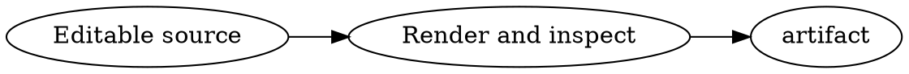

# Framework selection and validation

| Need | Starting choice | Limitation to verify |
|---|---|---|
| Small process, sequence or state diagram in Markdown | Mermaid | Host syntax/version; automatic layout is not exact placement |
| Standard interactive web data chart | Chart.js | Canvas backend, lifecycle, accessible table; standard export is raster |
| Exact icon, illustration or manually positioned diagram | SVG | Text/fonts, viewBox, clipping, host accessibility |
| Large directed dependency graph | Graphviz `dot` | Layout time, density, label readability; split overview/details |
| Custom interactive data relationships or unusual encodings | D3 | More integration code, scales/joins and interaction testing |
| Declarative statistical chart specifications | Vega-Lite, after checking its official versioned docs | Schema/export/runtime compatibility; not researched deeply in this batch |
| Publication scientific figure | Established plotting tool | Fonts, units, vector export, reproducible calculations |

Decision procedure:

1. Enforce destination and editable-format requirements first.
2. Identify semantic structure, then acceptable interaction and complexity.
3. Choose the least complex renderer that preserves the meaning.
4. Render the densest representative specimen before scaling up.
5. Provide source plus export and a meaningful alternative description.

Graphviz example, original fixture:

Run `dot -Tsvg workflow.dot -o workflow.svg`, record `dot -V`, parse the SVG and visually inspect labels/arrows. Rendering success does not prove a large graph is readable. `dot` favors directed hierarchy; other Graphviz engines serve different layouts. Probe local output formats instead of assuming every plugin is installed.

Acceptance examples: a process diagram preserves branches and their labels; a data chart preserves the source rows and units; a dependency graph preserves all edge endpoints or explicitly scopes an overview. For Chart.js use a host data table/summary rather than treating canvas pixels as an accessible equivalent. For SVG keep text or a clear font dependency in the editable master. For Mermaid validate in the target host, whose version may differ from a standalone CLI.

Unavailable specialist skills do not block selection. Unavailable renderers block only claims of rendered verification. A fallback must retain required meaning, privacy, editability and delivery format; otherwise deliver the source and explain the pending check.
